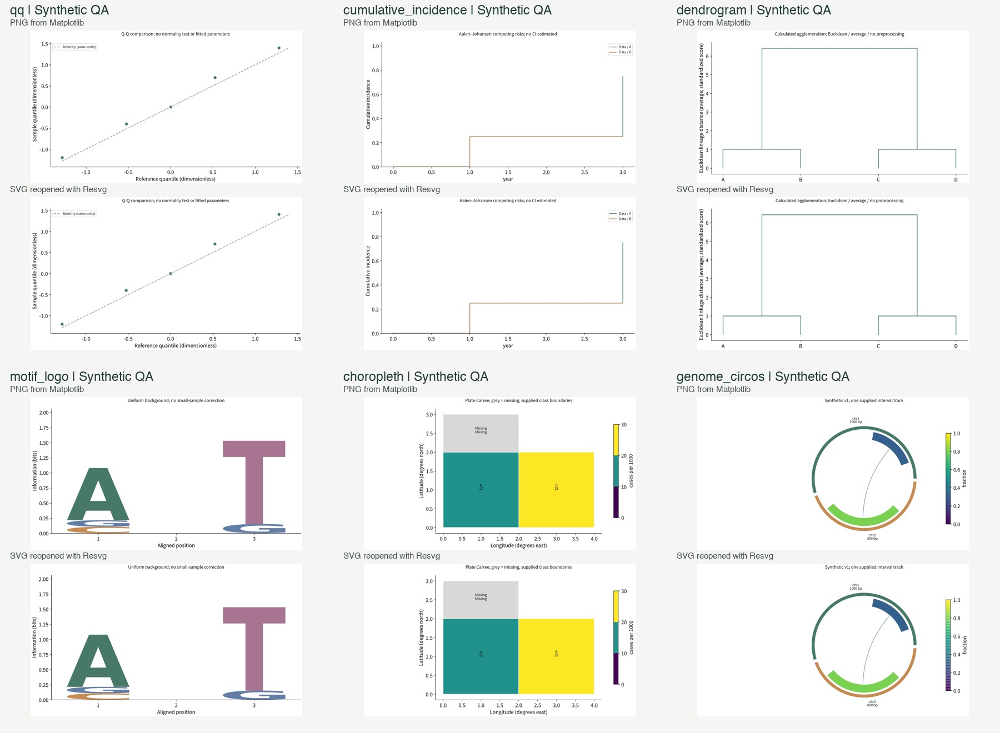

# 信息图生成能力补齐与验收 · 2026-10-10

> 后续功能验收：状态转移 SVG 与混合组合 SVG 已完成生成／评审流程修复，并在新的原输入真实运行和独立终审中均通过。成图、1258 项 Core 测试及全部调用记录见 [SVG 修复最终报告](../svg-repair-20261010/README.md)。下面的失败状态和矩阵保留前一轮历史，不回写成通过。

> 后续验收记录更正（2026-10-10）：SVG 修复测试误覆盖了本目录旧 `composite-core` 的 8 个模拟产物及 `composite-core-matrix.json`，原文件未恢复；这些当前文件不能作为本报告原轮次的历史产物证据。旧百炼真实验收记录不受影响。详见 [来源说明](evidence/composite-evidence-provenance-notice.json)；新的组合回归证据另存于 [SVG 修复报告](../svg-repair-20261010/README.md)。

本轮已在指定 4.0 工作树实现 23 类原候选数据图、全部 63 类数据图的同场景 PNG/SVG，以及 2 类独立子图组合流程。27 类示意/领域图的双格式约束传递已逐类模拟验收。真实百炼验收完成 3 个代表场景：流程图 PNG 通过；状态转移 SVG 改稿未复审且人工检查仍有错误；混合组合 SVG 保留问题状态。不能据此声称 92 类真实模型生成质量全部通过。

工作树：`/Users/a1-6/.config/superpowers/worktrees/paperbanana-tuyan/tuyan-v400-workflow-20261009`；分支 `codex/tuyan-v400-workflow-20261009`，基线 `5e6989f59416e44d9f22fd26703d3830ed861ea7`。改动留在本地，未提交、部署。224 个小程序文件及 12 个原 SVG 渲染器/字体文件共 236 个受保护文件 hash 未变，见 [保护检查](evidence/preservation-check.json)。本轮新建独立的程序 SVG 渲染器，未覆盖邻会话的严格模型 SVG 评审实现。

## 交付入口

- [92 类逐图型支持目录](support-catalog.md)，含变更前状态；[184 路径验证矩阵 CSV](support-matrix.csv) / [完整 JSON](support-matrix.json)。
- [63 类实际输入、计算与核查目录](data-inputs-and-computations.md)；每类链接真实测试输入、PNG 和可编辑 SVG。
- [142 个变体与 8 个分析方法的单独状态](variant-and-analysis-support.json)。变体已定义不等于已实现，逐变体验收计数为 0。
- [百炼实际调用汇总](live-validation.json)，保留所有失败尝试、实际请求/响应、用量、原图和版本记录。
- 既有 [分类规范](../catalog.md)、[旧新映射](../mapping.md)、[逐图许可](../references.md)、[图库扩充报告](../expansion-20261010.md) 继续适用。正式图库 107 案例、67 篇论文；89 个真实论文预览、3 个教学预览。当前生成工作没有把教学预览混入检索池或更改来源许可。

## 本轮计数与支持边界

|项目|数量|证据含义|
|---|---:|---|
|基础具体图型 / 大类|92 / 13|63 数据、27 示意或领域图、2 组合|
|新增专属数据渲染|23|所有候选基础形态实际程序输出，不靠解除禁用|
|数据双格式路径|126|63 × PNG/SVG；实际 Core、沙箱 Python、数值图元核查，模型意见模拟|
|示意双格式路径|54|27 × PNG/SVG；真实参考图片字节进入规划；生成/评审响应模拟|
|组合双格式路径|4|混合组合与分面 × PNG/SVG；数值子图真实程序，示意子图模型响应模拟|
|输入与边界拒绝|360|覆盖 63 类，包含空数据、10,001 行上限、缺来源、未实现变体及适用的非有限数值/单位缺失|
|专门数值已知答案 / 额外边界成图|31 / 16|Aalen–Johansen、分位数、面积、信息量、聚类等；见候选证据|
|SVG 独立重开与组合|63|另一渲染器 Resvg 打开真实 SVG，每个又参与一次组合|
|真实模型代表场景|3|1 通过、1 改稿未复审、1 有问题；其余逐类型/格式待实测|
|定义的变体 / 逐变体验收|142 / 0|数据与组合变体拒绝，示意变体仅要求传递|
|具名分析方法|8|接受已计算结果与方法说明；原始数据自动分析未实现|

这些计数可从 [counts.json](counts.json) 重算。数据基础形态均限定算法和输入范围，不能把“63 类已实现”理解成所有领域分析、所有布局变体或任意复杂输入均已验证。

## 23 类新增的实际工作

- **关系/流量/集合**：network、euler、sankey、chord、alluvial。节点/边、集合成员或分阶段队列由用户给出；程序计算度数、精确集合计数、流量宽度和队列连接。Euler 为两集合拓扑及精确标签、非面积等比；Sankey 为双阶段；chord 为无向；alluvial 需各阶段队列总量一致。
- **分布/多变量/生存**：radar、qq、streamgraph、cumulative_incidence、matrix_link_overlay、parallel_coordinates。显式雷达轴范围、Hazen 分位点、对称基线堆叠、Aalen–Johansen 竞争风险、原始矩阵/外部连线及平行轴归一化均有独立输入校验。竞争风险限定共同零时入组、右删失，不估计置信区间；矩阵叠加中的 P 值/系数由用户提供，不替用户运行 Mantel 检验。
- **层级/地图**：treemap、circle_packing、point_map、choropleth。程序计算树形总量、切片面积与叶圆面积；圆堆积基础采用不重叠的嵌套排列，父圆含留白。地图限定显式经纬度的 Plate Carrée；区域图使用用户简单多边形和分级边界，不含孔洞或自动地理编码。
- **组学/树**：enrichment、gene_track、protein_domain、motif_logo、genome_circos、synteny、phylogenetic、dendrogram。富集 P 值与计数来自用户，程序计算比例；序列使用显式坐标/组装版本。Logo 计算频率与均匀背景信息量，无小样本/Bayesian 校正；Circos 单区间轨道拒绝同染色体重叠；共线性为两序列；系统发育树使用用户有根树及枝长。聚类计算欧氏距离和 single/complete/average linkage，或验证用户 linkage，最多 150 个观测。

8 个具名分析方法（PCA、PCoA、NMDS、CCA、RDA、UMAP、t-SNE、Mantel）均单独标记“用户预计算结果输入”。原始矩阵自动分析、显著性检验及对应专业变体没有计入本轮完成数量。算法来源和已知答案见 [独立实现报告](../../../.superpowers/sdd/plan/task-1-report.md) 与 [数值证据](evidence/candidates/independent-numeric-checks.json)。

## 实际怎么运行

1. **提交与保存**：Web 根据稳定 ID 显示图型专属字段、CSV/JSON 与结构化参数。所有模拟数据必须点选才填入，并明确来源。草稿按图型/面板保存；任务恢复保留图型、格式、数据、单位、选项与方法。Core 再校验，缺输入或未实现选项在付费调用前返回明确错误。新 Web 要求 `modelRegistry.figureExecutionVersion === 1`；旧 Core 仍可读取历史任务，但不能收到新执行请求。
2. **检索**：按具体图型及明确子图标注分精确/兼容档，主题/领域/密度/布局仅在结构档内排序；自动检索允许零结果。读取服务器许可记录并核对图片 SHA-256 后提交真实像素给主模型，或给辅助视觉后把观察报告交主模型。手选顺序保留，精确、兼容、未证明相容分别记录。组合图对子图再次按其类型检索，保留匹配原因；原论文数值和结论不迁移。
3. **主模型规划**：收到完整 `figureContract`，包括必要输入、元素、全部编码规则、数据、分析口径和逐类评审要求。数据图规划只允许声明的布局控制；模型返回的 Python 或替代数值不会执行。辅助视觉只提供观察，决定和完整方案由主模型负责。
4. **数据绘制**：固定渲染器按输入和选项生成程序，沙箱 Python 执行计算并核查实际图元。一次 Matplotlib 场景同时导出 PNG 与 SVG，记录数据/代码/两种输出 hash。矩阵从 raster `imshow` 改为矢量 mesh；色条也禁止栅格化。SVG 包含向量图元及文字节点，拒绝 `<image>`、脚本、外链。抗锯齿、字体栅格化可因查看器不同而异，数值、坐标和布局共用同一场景。
5. **示意绘制**：PNG 的生图模型获得完整方案、图型可执行约束、参考结构经验、禁止迁移项；真实论文图片已由规划阶段识读，不声称初次生图一定直接带原论文图。SVG 由主模型生成源码并真实渲染；原生 Recraft 路线保留，但本轮未实付测试。SVG/PNG 评审查看本版本实际画面，SVG 同时传完整代码；改稿不继承旧版“通过”。
6. **组合绘制**：每子图独立规划、绘制及评审；数据子图始终程序绘制，示意子图经 SVG 路线。编排器解析并隔离 ID/CSS，统一字体族、面板编号和网格，再导出最终 SVG 与同源 PNG。图例保留在各面板，避免合并不同语义/单位。分面当前同图型且显式独立尺度，共享坐标未开放。若启用评审，在子图后做一次整体画面与完整代码检查；所有子图和整体均通过才标通过，不追加隐形重试。
7. **数值保护**：程序校验与视觉意见分别保存。视觉模型不能签署数值/统计研究有效性。数据图及含数据子图的组合图禁用生图精修，服务端也在调用前拒绝；需恢复输入、改数据或布局后重新程序绘制。

万相 2.7 的实际请求含完整约束，存在 5,000 字符限额。本轮对完全相同的原文去重，绘制阶段只去掉浏览说明和参考论文长图注，保留全部执行要求；规划/评审和任务记录仍保留完整来源。超长方案明确阻断，不能截断。真实模型曾两次忽略预算，留下已付主模型请求记录；调整上下文与合成验收题后成功。不同内容长度仍可能触发明确限制。

## 验证与实际文件

本地证据包括 Core 最终全量 1,206/1,206、Web 650/650、taxonomy 73/73、Core 类型检查与双端构建。首次 Core 全量发现 5 个预期过期的断言（图库版本、同文去重字段、测试自身负向字段名），已修正并分别复跑；最终全量结果见 [Core 最终日志](evidence/core-final-rerun.log)。没有通过删除检查或放宽数值标准处理实际功能问题。

数值图实际绘制/重开：

- [数据 Core 矩阵](evidence/data-core-matrix.json)：126 条、原始数据与实际图元数值核查、两格式重复请求 hash 一致。
- [输入边界](evidence/input-boundaries.json)：63 类、360 次拒绝；[16 个科学边界成图](evidence/candidates/boundaries/results.json)。
- [63 个 SVG 重开](evidence/svg-roundtrip.json)：独立 Resvg 渲染并真实加入组合。
- [组合 Core 矩阵](evidence/composite-core-matrix.json)：4 条、每子图自动参考、实际数值 renderer、中文文件隔离、子图路由不可覆盖父级认证、最终版本检查与精修禁用。
- [示意传递矩阵](evidence/schematic-mock-matrix.json)：54 条；实际许可图片字节进入模拟模型请求，绘制/评审响应是模拟，不是实际效果。
- [重复进程输出](evidence/render-determinism.json)：UpSet 同频交集及系统发育树输入顺序稳定；各 8 个不同 Python 哈希种子，PNG/SVG hash 相同。
- [Web 最终测试](evidence/web-final-tests.log)、[Web 构建](evidence/web-final-build.log)、[Core 类型](evidence/core-typecheck.log)、[Core 构建](evidence/core-build.log)。构建保留既有大 bundle 提示，未做发布。

浏览器页连接只读图库验收服务（8793，不创建任务、不调用模型）；实际 Core 流程和真实百炼调用使用独立 runner，不将页面预览算作真实生成。在用户打开的 `127.0.0.1:5175` 验证了 Q-Q 独立参数、中文说明、模拟数据显式填入、不调用模型的数据检查、刷新与切换保留、图类搜索及能力说明；390px 宽度无横向溢出，参数单列显示。恢复了正常窗口及原流程图 PNG 设置。实际 App 行为测试覆盖 4K 混合图不要求未使用的图片 Key、完整任务恢复、旧 Core 阻断，以及退出登录后的迟到响应不能恢复前账户私有草稿。

## 百炼代表性实测与未过项

主模型及直接识图为 `qwen3.7-plus`，PNG 图像模型 `wan2.7-image-pro`。明确模拟科研输入、本地 Core/存储/网关、真实官方百炼端点；没有用模拟响应替换这些已付调用。

|场景|实际请求|结果|人工查看|
|---|---:|---|---|
|流程图 PNG 最终尝试|3|`passed`|开始/结束、处理步骤、判定菱形、yes/no 分支清楚|
|状态转移 SVG|4|`modified_unreviewed`|v2 的 cancel 仍连到错误状态，resume 附近拥挤；不能当通过|
|示意＋柱形数据 SVG|7|`issues_found`|数据 2/5/3 由程序正确绘制；示意面板连线/字号与整体排版仍需改进|
|PNG 早期超长方案尝试|2|请求后本地阻断|2 次主模型请求，未发生生图调用；另有 2 次纯本地预检失败|

合计 **16 次推理请求**：Qwen 15 次，输入 88,011、输出 17,533 tokens；Wan 1 次、1 张图，供应商报告 input 1,131 / output 2 / total 1,133，按其原单位记录。未核对实际账单金额，不把 token 合计冒充人民币费用。调用日志无密钥，临时凭据文件已移除。

通过的真实 PNG：[原图](evidence/live-bailian-png-retry/workflow-png/candidate-0.png)。保留问题的 SVG：[状态转移 v2](evidence/live-bailian/state-diagram-svg/candidate-0.svg)、[混合组合](evidence/live-bailian/mixed-workflow-bar-svg/candidate-0.svg)。这些现场结果不因后续本地字体修复而追溯改成“通过”。当前字体归一化另由程序像素检查确认。

## 剩余条件

1. 其余示意/领域图及格式的真实模型效果待测，按用户选择不进行全量付费 54 场景。已测 SVG 的科学连线错误需要继续调整输入/布局或模型并对新版重新评审；视觉评审也可能漏检，状态转移的错误语义就是实际例子。
2. 142 变体、共享尺度分面、自动专业统计分析、数据图生成式精修均没有冒充可用。数据输入的真实性与研究设计有效性仍需研究者确认，程序只核对给定数据、声明算法和图元。
3. 独立子图统一字体族和编号；极密集内容在 1K 组合后可能太小，需减少面板或提高分辨率。当前不承诺自动重排能解决所有论文版式，也不自动加付费轮次。
4. Mac 本地 Python/Resvg 和真实百炼调用不替代 Linux 生产 worker、真实对象存储、部署、账单或其他厂商测试。Web/Core/plot-worker 必须协同发布；Core 必须带程序 SVG worker、WASM、字体与论文图库资产。
5. 小程序及 Android/Windows/macOS 未在此轮同步验收。历史任务可读，新增能力通过独立执行版本门禁协商。

后续交接继续 `--lineage-id lin-8d844715eaed7a33`，`--parent-handoff-id 20261009-153125-codex-tuyan-v400-workflow-catalog-ui-local-01a0e6ff-aacc-7072-831c-`。原始恢复与前置状态不由本报告覆盖。
