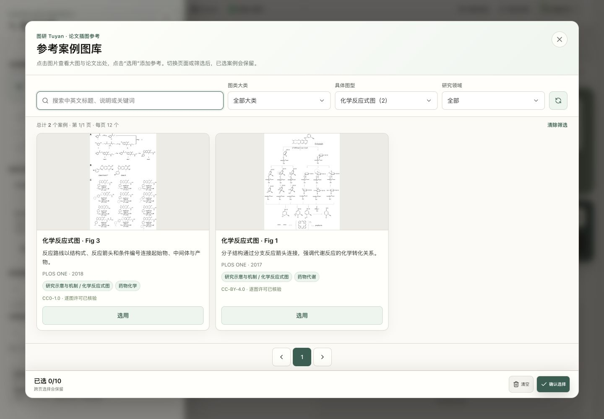
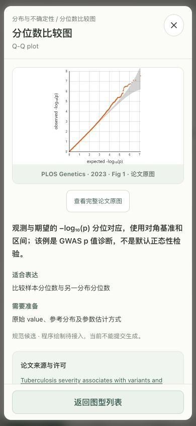

# 2026-10-10 真实论文图库扩充与预览替换

本地语料版本 `journal-2026-10-10.v2`，分类版本保持 `2026-10-10.v1`。在已确认的 4.0 工作树实施，保留并行 SVG、模型目录和小程序改动；未提交、部署或调用付费模型。

## 结果与计数口径

|项目|扩充前|本轮后|
|---|---:|---:|
|正式可用论文插图|69|107（新增 38）|
|正式池论文|35|67（新增 32）|
|有合格整体或子图案例的具体图型|63/92|89/92|
|零案例图型|29|3|
|选择器真实论文预览|61|89（替换 28）|
|选择器教学预览|31|3|
|隔离记录|7|7|
|台账记录（正式＋隔离）|76|114|

图库图型覆盖与代表预览是不同口径：有相关案例未必有适合缩小展示的预览。旧气泡、哑铃案例中不准确的类别标注也已纠正；因此不能直接用 31 减去旧零案例数来推断遗漏。全部 92 个具体图型仍有预览配置，3 个缺口明确保留结构示例。台账之外的研究候选不计入可用数量，也不作为参考检索候选。

当前正式池许可为 102 个 CC BY 4.0、5 个 CC0 1.0。按期刊身份归并 PLOS ONE/One 后为 10 个期刊，新增 PLOS Global Public Health 与 Implementation Science；106 张仍来自 PLOS，1 张来自 Implementation Science，出版方分布仍集中。新增案例涉及实施科学、化学、生态、细胞力学、遗传、社会科学、网络与可解释机器学习等。

## 31 个预览缺口的处理

|具体图型|处理|真实来源及体现特征|
|---|---|---|
|化学反应式图 (chemical_reaction)|替换为论文图|[PLOS ONE 2018 · Fig 3 / A](https://journals.plos.org/plosone/article?id=10.1371/journal.pone.0191423)：A 面板用分子结构、反应箭头与条件编号串起合成路线；完整条件保留在原始图注中。|
|能量剖面图 (energy_diagram)|替换为论文图|[PLOS ONE 2017 · Fig 4](https://journals.plos.org/plosone/article?id=10.1371/journal.pone.0179333)：反应物、中间体与过渡态按相对能量定位，分支及两种颜色比较不同反应路径和环境；横轴不是时间。|
|生物活动流图 (sbgn_af)|替换为论文图|[PLOS Computational Biology 2018 · Fig 1 / c](https://journals.plos.org/ploscompbiol/article?id=10.1371/journal.pcbi.1005740)：c 面板用活动节点和正向影响弧表达活动间影响；不使用 PD 的过程反应节点，也不等同 ER 的状态赋值。|
|泳道流程图 (swimlane)|替换为论文图|[Implementation Science : IS 2022 · Fig. 1 / a 中的泳道主体](https://link.springer.com/article/10.1186/s13012-022-01192-w)：执行者各占一条泳道，步骤之间的跨道箭头表明工作交接；完整原图的 c 面板为假设数据。|
|时间线 (timeline)|替换为论文图|[PLOS Biology 2023 · Fig 1](https://journals.plos.org/plosbiology/article?id=10.1371/journal.pbio.3002213)：带年份的历史里程碑沿时间顺序排列；这不是任务工期甘特图，也不是未来行动路线图。|
|层级树图 (hierarchy)|替换为论文图|[PLOS ONE 2019 · Fig 1](https://journals.plos.org/plosone/article?id=10.1371/journal.pone.0226222)：每个下位分类只有一个直接父类；分支仅表达包含层级，不表示进化枝长或聚类距离。|
|邻接矩阵图 (adjacency_matrix)|替换为论文图|[PLOS Neglected Tropical Diseases 2015 · Fig 1 / a](https://journals.plos.org/plosntds/article?id=10.1371/journal.pntd.0004266)：同一组作者同时排列于行和列，单元格表示节点间有无共著边；区别于样本—特征矩阵。|
|欧拉集合图 (euler)|替换为论文图|[PLOS Global Public Health 2025 · Fig 3](https://journals.plos.org/globalpublichealth/article?id=10.1371/journal.pgph.0004471)：集合只通过实际存在的交叠关系组织，未强制显示全部理论交集；面积拟合需结合原图注理解。|
|类别点图 (dotplot)|替换为论文图|[PLOS ONE 2025 · Fig 2](https://journals.plos.org/plosone/article?id=10.1371/journal.pone.0321072)：每一类别的回归估计用点的位置表达，区间单独绘制；点不是单个受试者的原始观测。|
|棒棒糖图 (lollipop)|替换为论文图|[PLOS ONE 2021 · Fig 3](https://journals.plos.org/plosone/article?id=10.1371/journal.pone.0251385)：细茎从共同零基线伸向数值端点，兼顾排序与精确位置；点大小不编码第三变量。|
|哑铃图 (dumbbell)|替换为论文图|[PLOS ONE 2018 · Fig 1](https://journals.plos.org/plosone/article?id=10.1371/journal.pone.0199554)：每个类别有两个组别端点，在同一数值轴上用水平线连接，突出两组差距而非个体轨迹。|
|瀑布增量图 (waterfall)|替换为论文图|[PLOS ONE 2022 · Fig 4 / F1](https://journals.plos.org/plosone/article?id=10.1371/journal.pone.0272825)：以 E[f(X)] 为基准，正负 SHAP 贡献用相接的悬浮条累加到预测值 f(x)；不是普通增减柱形图。|
|核密度图 (density)|替换为论文图|[PLOS One 2025 · Fig 2](https://journals.plos.org/plosone/article?id=10.1371/journal.pone.0325214)：同一连续变量的平滑密度曲线比较两组分布；纵轴是密度，不是计数或每点概率。|
|山脊密度图 (ridgeline)|替换为论文图|[PLOS ONE 2022 · Fig 8 / a](https://journals.plos.org/plosone/article?id=10.1371/journal.pone.0260687)：多组密度曲线沿纵向错开，共用横轴比较分布，并叠加观测点及分位线；纵向偏移不代表时间。|
|经验累积分布图 (ecdf)|替换为论文图|[PLOS Computational Biology 2024 · Fig 5 / D](https://journals.plos.org/ploscompbiol/article?id=10.1371/journal.pcbi.1011937)：D 面板累计比例从 0 上升到 1，比较误差阈值以下的样本占比；原论文此图来自模拟研究。|
|分位数比较图 (qq)|替换为论文图|[PLOS Genetics 2023 · Fig 1](https://journals.plos.org/plosgenetics/article?id=10.1371/journal.pgen.1010387)：观测与期望的 −log₁₀(p) 分位对应，使用对角基准和区间；该例是 GWAS p 值诊断，不是默认正态性检验。|
|面积趋势图 (area)|替换为论文图|[PLOS Computational Biology 2024 · Fig 4 / B](https://journals.plos.org/ploscompbiol/article?id=10.1371/journal.pcbi.1011795)：B 面板的数量序列由零基线开始堆叠，以带厚比较组成随时间的变化；A 面板则表示比例。|
|气泡散点图 (bubble)|替换为论文图|[PLOS Computational Biology 2020 · Fig 5](https://journals.plos.org/ploscompbiol/article?id=10.1371/journal.pcbi.1007732)：二维坐标外，圆大小按 K 图例表达第三变量，颜色区分门类；保留大小图例以区别普通散点。|
|二值存在矩阵 (binary_matrix)|替换为论文图|[PLOS Computational Biology 2020 · Fig 1 / Presence/Absence matrix](https://journals.plos.org/ploscompbiol/article?id=10.1371/journal.pcbi.1007732)：行是基因家族，列是基因组，0/1 表达存在或缺失；不是同一组节点之间的邻接矩阵。|
|相关矩阵图 (correlation_matrix)|替换为论文图|[PLOS ONE 2024 · Fig 2](https://journals.plos.org/plosone/article?id=10.1371/journal.pone.0314976)：相同指标按行列排列，单元格的数值与色标表示 Pearson 相关系数；相关不等于因果。|
|关联矩阵与网络叠合图 (matrix_link_overlay)|替换为论文图|[PLOS One 2026 · Fig 3](https://journals.plos.org/plosone/article?id=10.1371/journal.pone.0339350)：Pearson 相关矩阵外叠加 Mantel 连线，矩阵颜色和边粗、边色使用不同图例，不能混为一种检验。|
|平行坐标图 (parallel_coordinates)|替换为论文图|[PLOS ONE 2021 · Fig 9](https://journals.plos.org/plosone/article?id=10.1371/journal.pone.0253822)：同一网络的多个特征在平行数值轴上由一条折线贯穿；轴的标准化方式决定比较含义。|
|矩形树图 (treemap)|替换为论文图|[PLOS ONE 2019 · Fig 3 / B](https://journals.plos.org/plosone/article?id=10.1371/journal.pone.0205771)：B 面板用嵌套矩形表达职业分组，叶子面积表达份额；不同层级和面积分母需要明确。|
|冲积流转图 (alluvial)|替换为论文图|[PLOS Pathogens 2025 · Fig 1](https://journals.plos.org/plospathogens/article?id=10.1371/journal.ppat.1013369)：同一群体在国家、性别和传播类别间由流带连接，带宽表达人数；带的方向不代表感染传播。|
|分区设色地图 (choropleth)|替换为论文图|[PLOS ONE 2023 · Fig 7 / B](https://journals.plos.org/plosone/article?id=10.1371/journal.pone.0294812)：B 面板把国家汇总数量映射为区域颜色，底图来自 Natural Earth；数量不能解读为人均率，缺失也不等于零。|
|等值线图 (contour)|替换为论文图|[PLOS ONE 2018 · Fig 2](https://journals.plos.org/plosone/article?id=10.1371/journal.pone.0191835)：两项通量决定平面位置，标注数值的同值线表达模型计算标量场；同值线不是物质运动轨迹。|
|矢量场图 (vector_field)|替换为论文图|[PLOS Computational Biology 2015 · Fig 1 / C 中 λ=10⁻⁵ 条件](https://journals.plos.org/ploscompbiol/article?id=10.1371/journal.pcbi.1004076)：C 面板选定正则化条件下的箭头表示局部牵引向量，色标注明 Pa；完整原图比较其他正则化条件。|
|蛋白结构域图 (protein_domain)|替换为论文图|[PLOS ONE 2024 · Fig 1 / C](https://journals.plos.org/plosone/article?id=10.1371/journal.pone.0310962)：C 面板将结构域和截短位置沿氨基酸序列排列，以构建体对照体现区间与位点关系。|
|研究路线图 (roadmap)|保留结构示例|已核查的路线图候选只有文字清单或一般流程，缺少阶段、里程碑与依赖结构，继续使用结构示例。|
|流图 (streamgraph)|保留结构示例|候选论文虽称 streamgraph，实图为总量与子类在固定零线两侧的镜像面积，不能代表移动基线流图。|
|极坐标面积图 (rose)|保留结构示例|本轮未找到同时明确等角扇区、面积编码和许可的合格论文案例；普通径向长度柱不作替代。|

## 本轮新增的 38 个图库案例

每张只计算一次；具体子图映射记录于完整台账。多面板未拆成多张计数。

|案例 ID|主要图型|学科|期刊/年/图号|许可|来源|
|---|---|---|---|---|---|
|journal_pcbi.1005740.g001|并列比较示意图|生物网络|PLOS Computational Biology 2018 · Fig 1|CC-BY-4.0|[DOI](https://journals.plos.org/ploscompbiol/article?id=10.1371/journal.pcbi.1005740)|
|journal_pcbi.1005740.g003|并列比较示意图|生物网络|PLOS Computational Biology 2018 · Fig 3|CC-BY-4.0|[DOI](https://journals.plos.org/ploscompbiol/article?id=10.1371/journal.pcbi.1005740)|
|journal_pone.0306028.g003|山脊密度图|血管成像|PLOS ONE 2024 · Fig 3|CC-BY-4.0|[DOI](https://journals.plos.org/plosone/article?id=10.1371/journal.pone.0306028)|
|journal_pone.0260687.g008|山脊密度图|植物生态学|PLOS ONE 2022 · Fig 8|CC0-1.0|[DOI](https://journals.plos.org/plosone/article?id=10.1371/journal.pone.0260687)|
|journal_pone.0199554.g001|哑铃图|科研行为调查|PLOS ONE 2018 · Fig 1|CC-BY-4.0|[DOI](https://journals.plos.org/plosone/article?id=10.1371/journal.pone.0199554)|
|journal_pgph.0004471.g003|欧拉集合图|公共卫生|PLOS Global Public Health 2025 · Fig 3|CC-BY-4.0|[DOI](https://journals.plos.org/globalpublichealth/article?id=10.1371/journal.pgph.0004471)|
|journal_pcbi.1011795.g002|多面板组合图|传染病建模|PLOS Computational Biology 2024 · Fig 2|CC-BY-4.0|[DOI](https://journals.plos.org/ploscompbiol/article?id=10.1371/journal.pcbi.1011795)|
|journal_pcbi.1011795.g004|面积趋势图|传染病建模|PLOS Computational Biology 2024 · Fig 4|CC-BY-4.0|[DOI](https://journals.plos.org/ploscompbiol/article?id=10.1371/journal.pcbi.1011795)|
|journal_pone.0250938.g006|平行坐标图|金融经济学|PLOS ONE 2021 · Fig 6|CC-BY-4.0|[DOI](https://journals.plos.org/plosone/article?id=10.1371/journal.pone.0250938)|
|journal_pone.0253822.g009|平行坐标图|复杂网络|PLOS ONE 2021 · Fig 9|CC-BY-4.0|[DOI](https://journals.plos.org/plosone/article?id=10.1371/journal.pone.0253822)|
|journal_ppat.1013369.g001|冲积流转图|病原体流行病学|PLOS Pathogens 2025 · Fig 1|CC-BY-4.0|[DOI](https://journals.plos.org/plospathogens/article?id=10.1371/journal.ppat.1013369)|
|journal_pone.0312770.g005|冲积流转图|昆虫生态学|PLOS ONE 2024 · Fig 5|CC-BY-4.0|[DOI](https://journals.plos.org/plosone/article?id=10.1371/journal.pone.0312770)|
|journal_pone.0205771.g003|矩形树图|历史与计算社会科学|PLOS ONE 2019 · Fig 3|CC-BY-4.0|[DOI](https://journals.plos.org/plosone/article?id=10.1371/journal.pone.0205771)|
|journal_pone.0339350.g003|关联矩阵与网络叠合图|土壤生态学|PLOS One 2026 · Fig 3|CC-BY-4.0|[DOI](https://journals.plos.org/plosone/article?id=10.1371/journal.pone.0339350)|
|journal_pgen.1010387.g001|分位数比较图|基因组学|PLOS Genetics 2023 · Fig 1|CC-BY-4.0|[DOI](https://journals.plos.org/plosgenetics/article?id=10.1371/journal.pgen.1010387)|
|journal_pntd.0004266.g001|并列比较示意图|科研合作网络|PLOS Neglected Tropical Diseases 2015 · Fig 1|CC-BY-4.0|[DOI](https://journals.plos.org/plosntds/article?id=10.1371/journal.pntd.0004266)|
|journal_pcbi.1011937.g005|多面板组合图|进化建模|PLOS Computational Biology 2024 · Fig 5|CC-BY-4.0|[DOI](https://journals.plos.org/ploscompbiol/article?id=10.1371/journal.pcbi.1011937)|
|journal_pone.0310962.g001|蛋白结构域图|分子生物学|PLOS ONE 2024 · Fig 1|CC-BY-4.0|[DOI](https://journals.plos.org/plosone/article?id=10.1371/journal.pone.0310962)|
|journal_pbio.3002213.g001|时间线|生物图像分析|PLOS Biology 2023 · Fig 1|CC-BY-4.0|[DOI](https://journals.plos.org/plosbiology/article?id=10.1371/journal.pbio.3002213)|
|journal_pcbi.1007732.g001|方法框架图|泛基因组学|PLOS Computational Biology 2020 · Fig 1|CC-BY-4.0|[DOI](https://journals.plos.org/ploscompbiol/article?id=10.1371/journal.pcbi.1007732)|
|journal_pcbi.1007732.g005|气泡散点图|泛基因组学|PLOS Computational Biology 2020 · Fig 5|CC-BY-4.0|[DOI](https://journals.plos.org/ploscompbiol/article?id=10.1371/journal.pcbi.1007732)|
|journal_pcbi.1004076.g001|多面板组合图|细胞力学|PLOS Computational Biology 2015 · Fig 1|CC-BY-4.0|[DOI](https://journals.plos.org/ploscompbiol/article?id=10.1371/journal.pcbi.1004076)|
|journal_pcbi.1004076.g002|方法框架图|细胞力学|PLOS Computational Biology 2015 · Fig 2|CC-BY-4.0|[DOI](https://journals.plos.org/ploscompbiol/article?id=10.1371/journal.pcbi.1004076)|
|journal_pone.0314976.g002|相关矩阵图|科研评价|PLOS ONE 2024 · Fig 2|CC-BY-4.0|[DOI](https://journals.plos.org/plosone/article?id=10.1371/journal.pone.0314976)|
|journal_pone.0314976.g003|棒棒糖图|科研评价|PLOS ONE 2024 · Fig 3|CC-BY-4.0|[DOI](https://journals.plos.org/plosone/article?id=10.1371/journal.pone.0314976)|
|journal_pone.0294812.g007|多面板组合图|科研基础设施|PLOS ONE 2023 · Fig 7|CC-BY-4.0|[DOI](https://journals.plos.org/plosone/article?id=10.1371/journal.pone.0294812)|
|journal_pone.0251385.g003|棒棒糖图|病理学|PLOS ONE 2021 · Fig 3|CC-BY-4.0|[DOI](https://journals.plos.org/plosone/article?id=10.1371/journal.pone.0251385)|
|journal_pbio.3002645.g002|山脊密度图|科学传播|PLOS Biology 2024 · Fig 2|CC-BY-4.0|[DOI](https://journals.plos.org/plosbiology/article?id=10.1371/journal.pbio.3002645)|
|journal_pone.0325214.g002|核密度图|社会科学|PLOS One 2025 · Fig 2|CC-BY-4.0|[DOI](https://journals.plos.org/plosone/article?id=10.1371/journal.pone.0325214)|
|journal_pone.0226222.g001|层级树图|鱼类分类|PLOS ONE 2019 · Fig 1|CC-BY-4.0|[DOI](https://journals.plos.org/plosone/article?id=10.1371/journal.pone.0226222)|
|journal_pone.0141039.g001|层级树图|海洋生态学|PLOS ONE 2015 · Fig 1|CC-BY-4.0|[DOI](https://journals.plos.org/plosone/article?id=10.1371/journal.pone.0141039)|
|journal_pone.0191423.g003|化学反应式图|药物化学|PLOS ONE 2018 · Fig 3|CC0-1.0|[DOI](https://journals.plos.org/plosone/article?id=10.1371/journal.pone.0191423)|
|journal_pone.0321072.g002|类别点图|社会科学|PLOS ONE 2025 · Fig 2|CC-BY-4.0|[DOI](https://journals.plos.org/plosone/article?id=10.1371/journal.pone.0321072)|
|journal_pone.0179333.g001|化学反应式图|药物代谢|PLOS ONE 2017 · Fig 1|CC-BY-4.0|[DOI](https://journals.plos.org/plosone/article?id=10.1371/journal.pone.0179333)|
|journal_pone.0179333.g004|能量剖面图|计算化学|PLOS ONE 2017 · Fig 4|CC-BY-4.0|[DOI](https://journals.plos.org/plosone/article?id=10.1371/journal.pone.0179333)|
|journal_pone.0191835.g002|等值线图|代谢工程|PLOS ONE 2018 · Fig 2|CC-BY-4.0|[DOI](https://journals.plos.org/plosone/article?id=10.1371/journal.pone.0191835)|
|journal_s13012-022-01192-w.g001|泳道流程图|实施科学与医疗服务|Implementation Science : IS 2022 · Fig. 1|CC-BY-4.0|[DOI](https://link.springer.com/article/10.1186/s13012-022-01192-w)|
|journal_pone.0272825.g004|瀑布增量图|可解释机器学习与糖尿病|PLOS ONE 2022 · Fig 4|CC-BY-4.0|[DOI](https://journals.plos.org/plosone/article?id=10.1371/journal.pone.0272825)|

## 逐图核验与数据边界

[38 张逐图审核记录](evidence/expansion-20261010-audit.json)绑定原始文章 XML、原图、出版方 PNG、完整图注的 SHA-256，并分别记录存储、展示、模型输入和改编条件。[完整台账](reference-register.json)保留论文标题、全体作者、期刊、年份、DOI、图号/子图、许可原文及链接、署名、修改记录、类型和不可迁移内容。

依据[CC BY 4.0](https://creativecommons.org/licenses/by/4.0/)的复制与改编许可及[CC0 1.0](https://creativecommons.org/publicdomain/zero/1.0/)逐条核对，不以免费阅读或可以下载代替许可。模型输入判断针对单次结构参考所需的复制与改编，不声称取得额外训练、商标或隐私授权，也不代替模型服务商条件。CC BY 展示保留作者、论文、图号、来源、许可及修改说明；CC0 保留学术溯源。

特殊处理：泳道论文同时具有文章 CC BY 4.0 和数据 CC0 声明，采用文章许可；原图的假设数据在完整图注与预览说明中保留。分区设色地图的图注明确使用 Natural Earth，另核验其[公有领域条款](https://www.naturalearthdata.com/about/terms-of-use/)。对含 GADM 地图的论文只批准本次审查的非地图图号，不把单图许可结论外推到同文其他图。

[未采用候选记录](evidence/expansion-rejected-candidates.json)说明结构不匹配、编码不清楚和许可受限的实际排除原因；它不是对这些论文整体质量的判断。尤其没有把固定零线的镜像面积当作流图，也没有把径向长度柱当作面积编码的玫瑰图。

## 接入、性能与验证

- 新图通过同一稳定 ID 注册表进入图库、筛选、自动检索、类型参考规范和预览；自动检索仍优先精确主图型/子图匹配。旧 ID 保留，未批准候选和旧 7 张隔离记录不进入正式池。
- 代表预览人工指定面板与裁剪，一句话说明科学结构。重点调整二值矩阵、等值线、矢量场、ECDF、面积图及泳道的范围，保留相应图例、坐标或完整上下文；放大可返回原论文完整图。
- 新增通用 JATS/PNG 导入路径，支持本次 Implementation Science 原尺寸 PNG；PLOS 继续保留 TIFF 与出版方 PNG，文件格式不冒充。刷新脚本只读取人工审核清单，不因下载成功自动批准。
- 全部 92 个缩略图合计 2,436,170 bytes，单图不超过 250 KB、尺寸不超过 960×600，保持按需加载。Web 原图库资源约 88 MiB，Core 原始/预览资产含研究候选约 248 MiB；这些体积不是页面首次加载量。
- 分类/图库测试 [10/10](evidence/expansion-taxonomy-tests.log)：原始文件/图注/许可哈希、4 种用途、全部新增主图型及子图的筛选和精确匹配、历史 ID、隔离门禁。
- Web 定向测试 [30/30](evidence/expansion-web-tests.log)：全部预览覆盖、解码/体积/来源、独立放大、候选状态、图库切页回顶等。
- Web [构建通过](evidence/expansion-web-build.log)。主分块 4,753.07 KB（gzip 655.55 KB），仍有大分块提示，后续可拆分目录及模型数据。
- Chrome 1440×1000 核验新泳道来源详情与化学反应式筛选（2 个）；流图筛选显示 0 和明确缺图提示。390×844 核验 Q–Q 真实论文预览，图片加载成功、无横向溢出（390/390），仍显示程序绘制待接入。截图见下方。

本轮没有改变生成能力：92 类型、142 变体定义；40 种基础数据图已有先前合成数据程序验证，27 种示意/领域图已接约束，2 种组合仅支持示意子图，23 种候选仍未开放。89 种有真实论文预览不等于 89 种生成效果验证完成。未做真实模型逐类型成图、生产镜像或其他客户端验收。

[全部 92 类覆盖表](evidence/expansion-coverage.csv)。复现：先按人工审核清单运行 `python3 scripts/figures/refresh-curated.py`，再运行 `node scripts/figures/build-type-previews.mjs` 和 `node scripts/figures/export-catalog.mjs`；修改原图或图注会触发新增审核哈希不匹配，必须重新审核。

